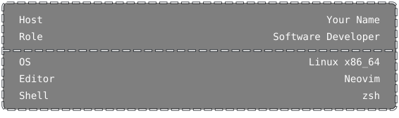
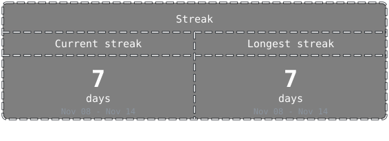

# termcard

Generate terminal-styled SVG profile cards (typing banner, info box, GitHub streak, and links) from a single JSON config via GitHub Actions.

**Visual Web Builder:** https://termcard.vercel.app/

<p align="center">
  <br>
  <br>
  <br>
  
</p>

## Features
- Four card types (`typing`, `info`, `streak`, `link`) and five built-in themes (`dashed-dark`, `dashed-light`, `solid-dark`, `solid-light`, `terminal-green`).
- Zero external dependencies (Python 3 standard library only) with optional auto-injection between `<!-- TERMCARD:START -->` and `<!-- TERMCARD:END -->`.
- Static visual builder in `web/` (deployable directly to Vercel) to edit cards and copy `termcard.json` plus workflow YAML.

## Usage

Copy [`examples/termcard.json`](examples/termcard.json) into your profile repo as `termcard.json`, then add `.github/workflows/termcard.yml`:

```yaml
name: Update termcard
on:
  push: { paths: ["termcard.json"] }
  schedule: [{ cron: "0 17 * * *" }]
  workflow_dispatch:
permissions: { contents: write }
jobs:
  build:
    runs-on: ubuntu-latest
    steps:
      - uses: actions/checkout@v4
      - uses: bagasadh/termcard@v1
        with:
          config: termcard.json
          output_dir: assets
          readme: README.md
          token: ${{ secrets.GITHUB_TOKEN }}
```

Run locally: `python3 termcard.py --config examples/termcard.json --out assets --skip-streak` or preview the web builder with `python3 -m http.server 3000 -d web`.
